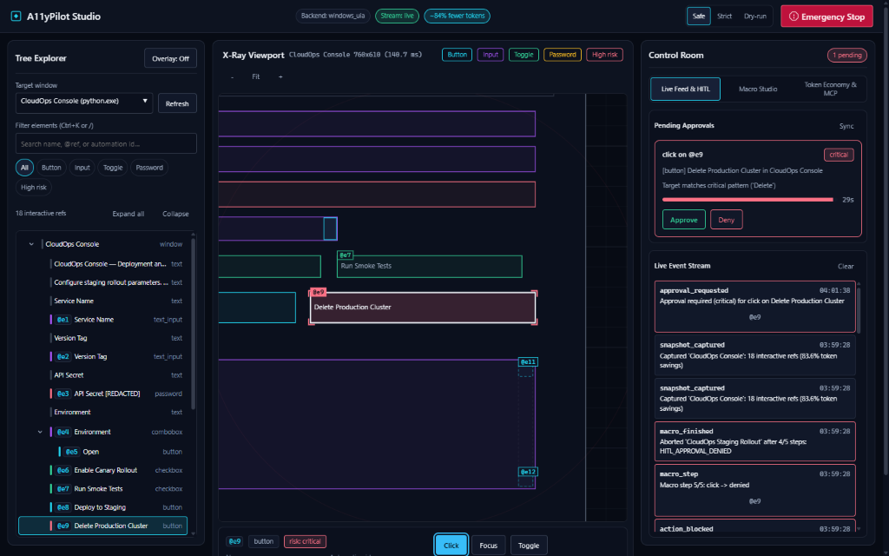
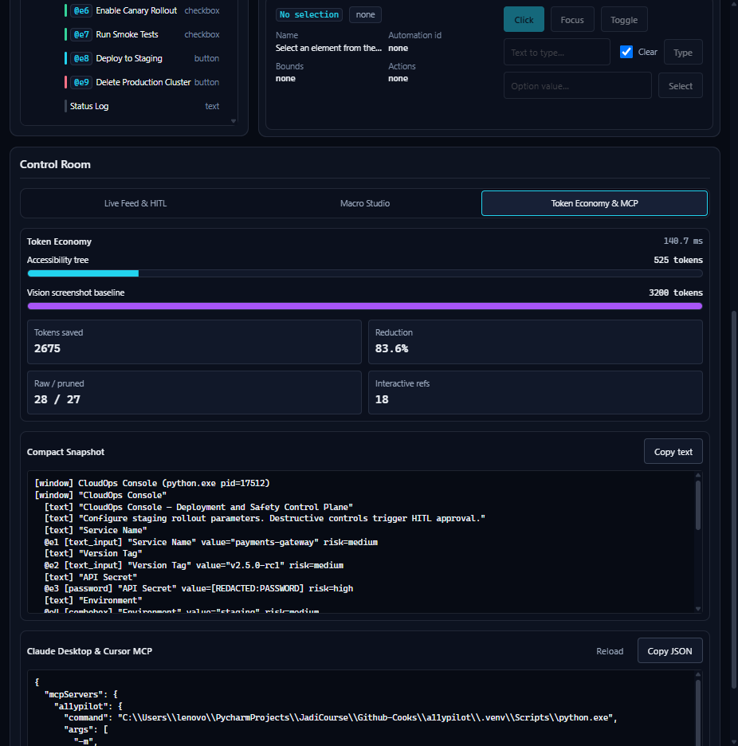
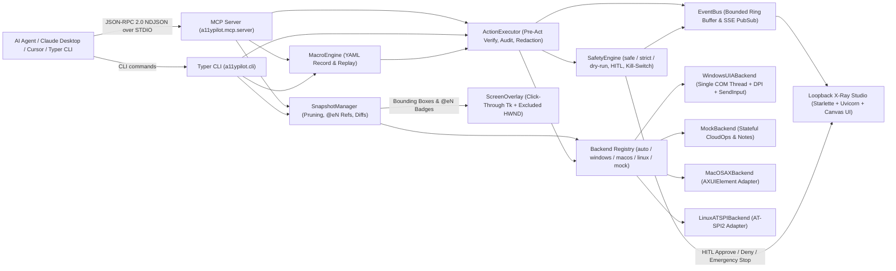

# A11yPilot

**Screenshot-free, safety-first desktop automation engine, pure-STDIO MCP server, and 60fps X-Ray control studio powered by native OS Accessibility Trees.**

[](https://github.com/AryaMehr-Nam/a11ypilot/actions/workflows/ci.yml)
[](https://www.python.org/downloads/)
[](LICENSE)

> **Language / زبان:** [English Guide](#english-guide) | [راهنمای کامل فارسی (Persian)](#persian-guide) ([Standalone RTL Persian file](README.fa.md))

---

<a id="english-guide"></a>
## English Guide

### What A11yPilot Does

Vision-based computer-use agents burn thousands of tokens per turn sending full desktop screenshots and still guess pixel coordinates blindly. **A11yPilot** takes the semantic route:

1. **Reads Native OS Accessibility Trees:** First-class Windows UI Automation (`IUIAutomation` via `comtypes` inside an isolated COM worker thread + 64-bit `SendInput` fallback), pluggable macOS `AXUIElement` and Linux `AT-SPI2` adapters, plus a stateful cross-platform `MockBackend` for deterministic testing and CI.
2. **Compresses UI Into Compact `@eN` Maps:** Enforces `max_depth=8`, `max_nodes=300`, `timeout_seconds=2.5`, cycle detection, invisible-noise pruning, and anonymous container flattening—cutting prompt payload by **~84%–89%** compared to a 1080p vision screenshot.
3. **Protects Destructive Workflows with Safety Gates & HITL:** Classifies every element and action (`LOW`, `MEDIUM`, `HIGH`, `CRITICAL`), blocks stale references (`STALE_ELEMENT_REF`), redacts passwords at source (`[REDACTED:PASSWORD]`), pauses destructive actions for Human-in-the-Loop (HITL) approval, and exposes an instant **Emergency Stop** kill-switch.
4. **Renders a Live 60fps Localhost X-Ray Control Studio:** Zero-CDN, zero-XSS pure-DOM control room visualizing live window wireframes, bidirectional tree sync, sonar action pulses, interactive HITL approval cards, semantic YAML macro recording/replay, and real-time token telemetry.
5. **Bridges Directly to AI Agents via Pure-STDIO MCP:** Exposes 10 desktop tools over strict UTF-8 NDJSON JSON-RPC 2.0 (`stdout` reserved exclusively for frames; all diagnostics routed to `stderr`), optionally co-hosting the live Studio for browser-based HITL oversight.

---

### Visual Tour (Live Windows UIA Demo)


*Live `WindowsUIABackend` capture of the native Win32 `CloudOps Console`: Tree Explorer (`18` refs, `API Secret` redacted), X-Ray Viewport (`140.7 ms`), and active crimson HITL Approval Card pausing `Delete Production Cluster`.*


*Token Economy & MCP tab comparing live `525` A11y tokens against the `3,200`-token 1080p screenshot baseline (`83.6%` reduction), alongside copy-ready compact text and Claude Desktop / Cursor MCP configuration.*

---

### Architecture



---

### Token-Cost & Latency Comparison

Token telemetry is calculated in `prune_and_index_tree()` (`src/a11ypilot/backends/base.py`) as `max(1, math.ceil(compact_bytes / 4))` against a `3,200`-token 1080p high-detail screenshot baseline:

| Scenario | Vision Screenshot (1080p) | A11yPilot Output | Tokens Saved | Privacy & Precision |
| :--- | :--- | :--- | :--- | :--- |
| **`MockBackend` (`CloudOps Console`)** | `3,200` tokens | `373` tokens (`1,489` bytes, `11` refs) | **`88.34%`** (`2,827` saved) | `[REDACTED:PASSWORD]` + `[risk=...]` tags |
| **Live Win32 (`WindowsUIABackend`)** | `3,200` tokens | `514–525` tokens (`18` refs, `~141–149 ms`) | **`83.6%–83.94%`** (`2,675+` saved) | Native `CurrentIsPassword` redaction + `STALE_ELEMENT_REF` check |

---

### Installation & Quickstart

Requires **Python 3.11+**.

```bash
git clone https://github.com/AryaMehr-Nam/a11ypilot.git
cd a11ypilot
python -m venv .venv
```

Activate `.venv` and install with development/test dependencies:

- **Windows (PowerShell):**
  ```powershell
  .\.venv\Scripts\Activate.ps1
  python -m pip install -e ".[dev]"
  ```
- **macOS / Linux:**
  ```bash
  source .venv/bin/activate
  python -m pip install -e ".[dev]"
  ```

#### 1. Run the Interactive Demo (`CloudOps Console` + X-Ray Studio)

On Windows, `demo/demo_app.py` launches native Win32 controls (`CreateWindowExW` + `ES_PASSWORD`) so `WindowsUIABackend` inspects a genuine OS accessibility tree; on headless environments it falls back cleanly to `MockBackend` and preloads `demo/sample_macro.yaml`:

```bash
a11ypilot demo
# Or force headless mock mode without opening a browser tab:
a11ypilot demo --backend mock --no-open
```

#### 2. CLI Commands Reference

```bash
# List visible desktop windows (--json supported)
a11ypilot windows --backend auto
a11ypilot windows --backend mock --json

# Capture a pruned, password-redacted snapshot with token telemetry
a11ypilot snapshot "CloudOps" --backend mock
a11ypilot snapshot "CloudOps" --backend mock --format json

# Preview or execute a targeted action against @eN
a11ypilot act "CloudOps" click @e10 --backend mock --mode dry-run
a11ypilot act "CloudOps" type @e4 --text "payments-gateway" --backend mock

# Launch standalone X-Ray Studio on loopback port 8780
a11ypilot studio --port 8780 --backend auto --mode safe

# Replay semantic YAML macro playbooks
a11ypilot macro run demo/sample_macro.yaml --mode dry-run --backend mock
```

---

### Working With X-Ray Control Studio

1. **Tree Explorer (Left):** Switch windows, filter by name/`@ref`/`automation_id` (`Ctrl+K` or `/`), filter by role (`Button`, `Input`, `Toggle`, `Password`, `High risk`), toggle the native click-through screen overlay (`Overlay: On/Off`), and click any node to focus the camera on it.
2. **X-Ray Viewport & Action Sandbox (Center):** Pan and zoom the HiDPI wireframe canvas, inspect element properties (`bounds`, `automation_id`, `supported_actions`, `risk_level`), and test `Click`, `Focus`, `Toggle`, `Type`, or `Select` directly. Expanding cyan/crimson sonar ripples indicate executed vs. safety-gated actions.
3. **Control Room (Right — 3 Tabs):**
   - **Live Feed & HITL:** Real-time SSE stream (`GET /api/events`) plus frosted-glass **Pending Approvals** cards with a live countdown bar and one-click **Approve** / **Deny** controls.
   - **Macro Studio:** Record live actions into semantic YAML (with password text redacted automatically), load `demo/sample_macro.yaml`, edit YAML inline, replay step-by-step, or download `.yaml`.
   - **Token Economy & MCP:** View live token savings, copy compact snapshot text, and copy ready-to-paste MCP client JSON.
4. **Top Header Bar:** Switch execution mode (`Safe` / `Strict` / `Dry-run`) and engage or resume the **Emergency Stop** kill-switch.

---

### Claude Desktop & Cursor MCP Setup

Add to `claude_desktop_config.json` or `.cursor/mcp.json`:

```json
{
  "mcpServers": {
    "a11ypilot": {
      "command": "a11ypilot",
      "args": ["mcp", "--backend", "auto", "--mode", "safe", "--studio-port", "8780"]
    }
  }
}
```

*(When using a virtualenv without global activation, point `"command"` to `C:\\path\\to\\a11ypilot\\.venv\\Scripts\\python.exe` on Windows or `/path/to/a11ypilot/.venv/bin/python` on POSIX with `"args": ["-m", "a11ypilot.mcp.server", "--backend", "auto", "--mode", "safe", "--studio-port", "8780"]`.)*

| MCP Tool | Purpose | Key Arguments |
| :--- | :--- | :--- |
| `list_windows` | Enumerate visible windows (`window_id`, `hwnd`, `title`, `process_name`, `bounds`). | *(none)* |
| `inspect_window` | Capture pruned, password-redacted tree with `@eN` refs, risk tags, and telemetry. | `window_id`, `window_query`, `max_depth`, `max_nodes` |
| `find_elements` | Search snapshot elements by normalized role, name, or text. | `window_id`, `snapshot_id`, `role`, `name`, `text` |
| `click_element` | Click, double-click, or right-click by `@eN` ref or semantic selector. | `ref` / `target_*`, `click_type` |
| `type_text` | Enter text into `text_input` or `password` fields (redacted in logs/macros). | `ref` / `target_*`, `text`, `clear_first` |
| `toggle_element` | Toggle a `checkbox` or switch element. | `ref` / `target_*`, `window_id`, `snapshot_id` |
| `select_option` | Select an option or tab inside a `combobox`, list, or `tab`. | `ref` / `target_*`, `option` |
| `scroll_element` | Scroll an element or active window in a direction. | `ref` / `target_*`, `direction`, `amount` |
| `press_hotkey` | Send a key chord (e.g., `["Ctrl", "S"]`), gating dangerous chords. | `keys`, `window_id` |
| `run_macro` | Load and replay a YAML `MacroPlaybook` through all safety gates. | `yaml` or `path`, `window_id`, `window_query` |

---

### Safety Engine, HITL & Security Invariants

- **Execution Modes (`config/default-policy.yaml`):**
  - `safe` (default): Auto-allows `LOW`/`MEDIUM`; requires HITL approval for `HIGH` and `CRITICAL` targets (e.g., `delete`, `destroy`, `format`, `shutdown`, `drop`, `reset`, `pay`, `purchase`, `transfer`, `checkout`, `remove`, `send`, `confirm`, `publish`, `grant`, `revoke`, password inputs, terminal processes, system dialogs, and dangerous hotkeys like `Alt+F4`, `Ctrl+Alt+Del`, `Win+R`, `Ctrl+Shift+Delete`).
  - `strict`: Requires HITL approval for every mutating action (`MEDIUM`, `HIGH`, `CRITICAL`).
  - `dry-run`: Performs live staleness verification and emits `action_preview` events without mutating OS state.
- **Fail-Closed Headless HITL & Kill-Switch:** Without an active interactive approver, gated actions deny immediately (`HITL_APPROVAL_REQUIRED`). `POST /api/emergency-stop` aborts pending approvals (`HITL_ABORTED_EMERGENCY_STOP`) and blocks further actions (`EMERGENCY_STOP_ACTIVE`) until resumed.
- **Stale-Ref Protection (`STALE_ELEMENT_REF`):** Re-verifies element existence, `role`, `name`/`automation_id`, `enabled`, and visibility immediately before executing mutations.
- **Windows COM Isolation & DPI Awareness:** Runs all `comtypes` / `IUIAutomation` calls inside a single dedicated daemon thread (`COINIT_MULTITHREADED` with `RPC_E_CHANGED_MODE` fallback), enables Per-Monitor v2 DPI awareness (`SetProcessDpiAwarenessContext(-4)`), uses 64-bit `SendInput` (`sizeof(INPUT) == 40`) normalized across virtual screen bounds, routes `comtypes` logs away from `stdout`, and excludes overlay HWNDs via `register_excluded_hwnd()`.
- **Hardened Loopback Studio:** Binds only to `127.0.0.1` / `localhost` / `::1` (`SO_EXCLUSIVEADDRUSE` on Windows), enforces `/?token=` → `302` `HttpOnly; SameSite=Strict` cookie bootstrap, validates `Host`, `Origin`, and `Sec-Fetch-Site: cross-site`, uses pure DOM (`createElement`/`textContent`) with zero external CDNs, and sets strict CSP headers on all responses.

---

### Development & Verification

```bash
ruff check src tests demo
ruff format --check src tests demo
mypy src
pytest -v
```

---

<a id="persian-guide"></a>
## راهنمای کامل فارسی (A11yPilot)

> برای مطالعه نسخه تماماً راست‌به‌چپ (RTL) می‌توانید فایل [README.fa.md](README.fa.md) را هم باز کنید.

### A11yPilot چیست و چه کاری انجام می‌دهد؟

اکثر ایجنت‌های کنترل دسکتاپ برای دیدن صفحه مدام اسکرین‌شات می‌گیرند؛ این کار هم هزاران توکن مدل‌های Vision را هدر می‌دهد، هم کند است، و هم ممکن است مختصات پیکسلی را اشتباه حدس بزند و روی دکمه خطرناکی کلیک کند.

**A11yPilot** به جای عکس گرفتن از صفحه، مستقیم به **درخت دسترس‌پذیری بومی سیستم‌عامل (OS Accessibility Tree)** وصل می‌شود:

1. **خواندن مستقیم ساختار واقعی پنجره‌ها:** روی ویندوز از `Windows UI Automation` (`IUIAutomation` / `comtypes`) داخل یک ترد ایزوله COM و `SendInput` شصت‌وچهار بیتی استفاده می‌کند، برای macOS (`AXUIElement`) و Linux (`AT-SPI2`) آداپتور دارد، و یک `MockBackend` قطعی برای اجرا و تست در محیط‌های بدون نمایشگر (CI) ارائه می‌دهد.
2. **فشرده‌سازی هوشمند و صرفه‌جویی ~۸۴٪ تا ۸۹٪ در توکن:** درخت شلوغ رابط کاربری را هرس می‌کند (`max_depth=8`, `max_nodes=300`, `timeout=2.5s`)، حلقه‌ها و لایه‌های اضافی را حذف می‌کند و المان‌های قابل تعامل را با شناسه‌های کوتاه `@e1`, `@e2`, ... شماره‌گذاری می‌کند.
3. **حفاظت ایمنی چندلایه و تایید انسانی (HITL):** تمام عملیات را به چهار سطح ریسک (`LOW`, `MEDIUM`, `HIGH`, `CRITICAL`) دسته‌بندی می‌کند. دکمه‌های حساس مثل `Delete`، ورودی‌های رمز عبور، پنجره‌های ترمینال و کلیدهای ترکیبی خطرناک (`Alt+F4`, `Ctrl+Alt+Del`) بدون تایید اپراتور اجرا نمی‌شوند.
4. **محافظت در برابر تغییر ناگهانی صفحه (`STALE_ELEMENT_REF`):** درست قبل از کلیک یا تایپ، مطمئن می‌شود المان هدف هنوز با همان `role` و `name` سر جایش هست تا ایجنت اشتباهی روی دکمه دیگری کلیک نکند.
5. **سانسور خودکار رمزهای عبور در مبدا:** هر فیلد رمز عبور یا ورودی با نام‌هایی مثل `Password` یا `API Secret` همان لحظه داخل بک‌اند به `[REDACTED:PASSWORD]` تبدیل می‌شود و هرگز وارد لاگ، ماکرو یا پاسخ LLM نمی‌شود.
6. **استودیوی کنترل وب با سرعت 60fps (`X-Ray Control Studio`):** بدون نیاز به Node.js یا CDN خارجی، نقشه وایرفریم پنجره، درخت المان‌ها، کارت‌های تایید انسانی (Approve/Deny)، ضبط و پخش ماکروهای YAML، دکمه توقف اضطراری (`Emergency Stop`) و نمودار صرفه‌جویی توکن را به صورت زنده نمایش می‌دهد.
7. **سرور خالص STDIO MCP:** آماده اتصال مستقیم به **Claude Desktop** و **Cursor** با ۱۰ ابزار استاندارد بدون هیچ‌گونه خروجی اضافه روی `stdout`.

---

### نصب و راه‌اندازی سریع

پیش‌نیاز: **پایتون 3.11 یا بالاتر**.

```powershell
git clone https://github.com/AryaMehr-Nam/a11ypilot.git
cd a11ypilot
python -m venv .venv
.\.venv\Scripts\Activate.ps1
python -m pip install -e ".[dev]"
```

*(در لینوکس و مک به جای اسکریپت پاورشل از `source .venv/bin/activate` استفاده کنید.)*

---

### روش‌های کار با پروژه (گام‌به‌گام)

#### ۱. اجرای دموی زنده و مشاهده استودیوی X-Ray

این دستور برنامه دسکتاپ **CloudOps Console** (با کنترل‌های بومی Win32 روی ویندوز) را به همراه استودیوی تحت وب روی `http://127.0.0.1:8780` و ماکروی آماده `demo/sample_macro.yaml` اجرا می‌کند:

```bash
a11ypilot demo
```

اگر نمایشگر ندارید یا می‌خواهید با شبیه‌ساز داخلی تست کنید:

```bash
a11ypilot demo --backend mock --no-open
```

در محیط استودیوی X-Ray:
- از ستون چپ (**Tree Explorer**) پنجره هدف را انتخاب و المان‌ها را جستجو یا فیلتر کنید.
- روی بوم مرکزی (**X-Ray Viewport**) مستقیماً روی باکس `@eN` کلیک کنید و با نوار پایین (**Action Sandbox**) دستور `Click`، `Type` یا `Toggle` بفرستید.
- در تب **Macro Studio** دکمه **Load sample_macro.yaml** و سپس **Replay Macro** را بزنید: ۴ مرحله اول روی برنامه واقعی اجرا می‌شوند و در مرحله ۵ (`Delete Production Cluster`) اجرای ماکرو متوقف می‌شود تا در تب **Live Feed & HITL** دکمه **Approve** یا **Deny** را بزنید!
- با دکمه قرمز **Emergency Stop** در نوار بالا می‌توانید کل اتوماسیون را در لحظه قفل کنید.

#### ۲. کار با دستورات خط فرمان (CLI)

```bash
# نمایش لیست پنجره‌های باز دسکتاپ
a11ypilot windows --backend auto
a11ypilot windows --backend mock --json

# گرفتن اسنپ‌شات فشرده درخت دسترس‌پذیری + آمار صرفه‌جویی توکن
a11ypilot snapshot "CloudOps" --backend mock
a11ypilot snapshot "CloudOps" --backend mock --format json

# تست امن (Dry-Run) یا اجرای یک دستور روی شناسه @eN
a11ypilot act "CloudOps" click @e10 --backend mock --mode dry-run
a11ypilot act "CloudOps" type @e4 --text "payments-gateway" --backend mock

# اجرای مستقل استودیوی X-Ray
a11ypilot studio --port 8780 --backend auto --mode safe

# اجرای فایل ماکرو با فرمت YAML (پشتیبانی از انتخابگرهای معنایی مستقل از @eN)
a11ypilot macro run demo/sample_macro.yaml --mode dry-run --backend mock
```

#### ۳. اتصال به Claude Desktop یا Cursor (MCP)

کافی است تنظیمات زیر را در `claude_desktop_config.json` یا `.cursor/mcp.json` قرار دهید تا ایجنت شما ابزارهای `list_windows`، `inspect_window`، `find_elements`، `click_element`، `type_text`، `toggle_element`، `select_option`، `scroll_element`، `press_hotkey` و `run_macro` را دریافت کند و هم‌زمان استودیوی زنده برای تایید انسانی روی پورت `8780` بالا بیاید:

```json
{
  "mcpServers": {
    "a11ypilot": {
      "command": "C:\\path\\to\\a11ypilot\\.venv\\Scripts\\python.exe",
      "args": [
        "-m",
        "a11ypilot.mcp.server",
        "--backend",
        "auto",
        "--mode",
        "safe",
        "--studio-port",
        "8780"
      ]
    }
  }
}
```

#### ۴. حالت‌های اجرایی موتور ایمنی (`config/default-policy.yaml`)

- **`safe` (پیش‌فرض):** عملیات عادی اجرا می‌شوند و عملیات `HIGH` و `CRITICAL` منتظر تایید انسانی (HITL) می‌مانند. (در حالت خط فرمان بدون استودیو، عملیات حساس بلافاصله با خطای `HITL_APPROVAL_REQUIRED` مسدود می‌شوند.)
- **`strict`:** هر گونه تغییر روی دسکتاپ بدون تایید اپراتور انجام نمی‌شود.
- **`dry-run`:** بدون تغییر واقعی در ویندوز یا برنامه، هدف را اعتبارسنجی می‌کند و پیش‌نمایش موج را روی بوم X-Ray نمایش می‌دهد.

---

### ساختار پوشه‌های پروژه

```text
a11ypilot/
├── config/default-policy.yaml      # سیاست پیش‌فرض ایمنی و الگوهای حساس
├── demo/
│   ├── demo_app.py                 # برنامه دمو CloudOps Console (بومی Win32 + Tkinter)
│   └── sample_macro.yaml           # سناریوی آماده ۵ مرحله‌ای با انتخابگرهای معنایی
├── docs/assets/                    # اسکرین‌شات‌های استودیوی X-Ray
├── src/a11ypilot/
│   ├── backends/                   # Windows UIA، Mock، macOS AX، Linux AT-SPI2 و موتور هرس درخت
│   ├── core/                       # SnapshotManager، SafetyEngine، ActionExecutor، MacroEngine، EventBus
│   ├── mcp/server.py               # سرور خالص STDIO JSON-RPC 2.0 MCP
│   ├── overlay/screen_overlay.py   # لایه شفاف نمایش شماره‌ها روی صفحه نمایش
│   ├── server/app.py               # سرور وب امن‌شده Starlette + SSE (فقط Loopback)
│   ├── ui/                         # رابط کاربری 60fps X-Ray بدون CDN و بدون innerHTML
│   └── cli.py                      # رابط خط فرمان Typer
└── tests/                          # ۵۵ تست واحد و یکپارچه‌سازی (Unit + Integration)
```
